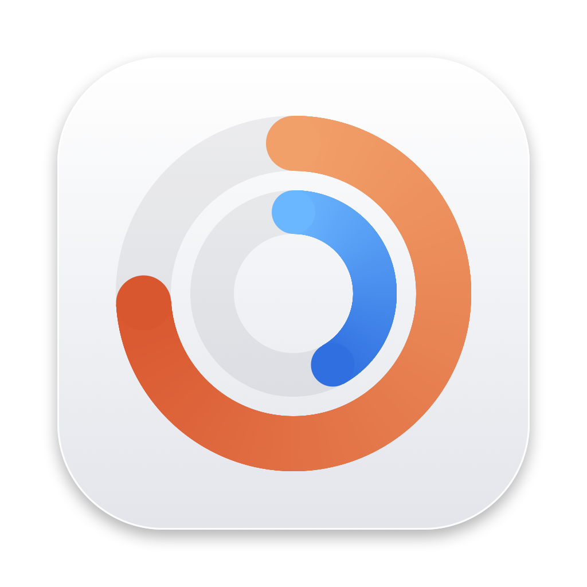
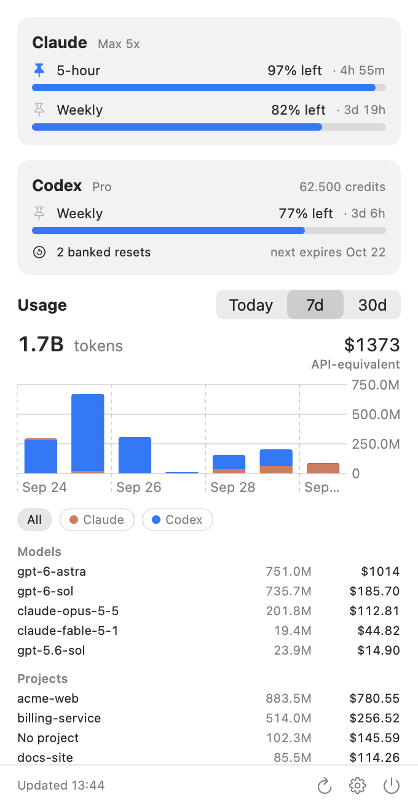
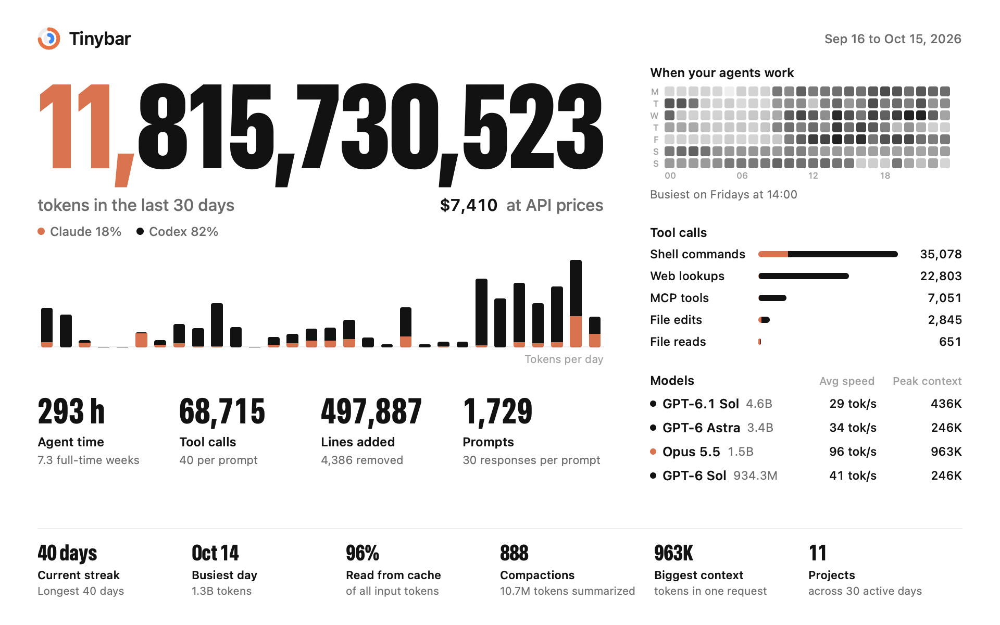

<p align="center"></p>

# Tinybar

**See what's left of your Claude, Codex, Gemini, Cursor and OpenCode Go limits from the macOS menu bar, plus the
tokens you used and what they would have cost at API prices.**

<p align="center">
  <a href="https://github.com/ThiloReintjes/tinybar/actions/workflows/ci.yml">
    </a>
  
  
  <a href="LICENSE">
    </a>
</p>

Tinybar is native AppKit and SwiftUI. It uses about 20 MB of memory and 0% CPU while the popover is
closed, and has no dependencies, no WebViews and no telemetry. It reads the logins your CLIs
already have and never changes anything on your account. It's a from-scratch alternative to
[CodexBar](https://github.com/steipete/CodexBar).

<p align="center">
  <picture>
    <source media="(prefers-color-scheme: dark)" srcset="docs/screenshot-dark.png">
    
  </picture>
</p>

## Install

```sh
brew install --cask thiloreintjes/tinybar/tinybar && open -a Tinybar
```

Or download the zip from [Releases](https://github.com/ThiloReintjes/tinybar/releases). Releases are
signed with Developer ID and notarized by Apple.

Tinybar starts at login and turns on every provider whose CLI you're signed in to, so there is
nothing to set up. When a new version is out, the popover shows **Update to x.y.z**, and one click
updates it through Homebrew. To uninstall, run `brew uninstall --cask thiloreintjes/tinybar/tinybar`
and add `--zap` to also delete your history and settings.

## What it shows

- **Every limit.** The 5-hour and weekly windows for Claude, Codex and Gemini, Cursor's billing
  cycle, and OpenCode Go's 5-hour, weekly and monthly windows, with reset countdowns. Model-specific limits, Claude extra usage, Cursor on-demand spend,
  Codex credits and banked resets are included.
- **When you'll run out.** At your pace so far, the time each window hits 0%. It turns orange if
  that comes before the reset.
- **One ring in the menu bar** for the limit closest to running out, or the one you pin.
- **Several accounts.** Other Claude and Codex logins in your home folder are picked up by themselves
  (`~/.claude_personal`, `~/.codex_alt`), and accounts from
  [claude-swap](https://github.com/realiti4/claude-swap) if you turn that on in Settings. A subscription's
  number becomes the average of what they have left, with a bar showing each one. Its page lists them all.
- **Outages.** When Claude Code, Codex, Cursor or OpenCode Go report trouble on their status page, the ring gets
  an orange or red light, and the subscription's page links to the incident.
- **Token history and cost.** Today, 7 days and 30 days from your Claude Code and Codex logs and
  your OpenCode Go use, by model and project, priced at [models.dev](https://models.dev) API rates. Tinybar keeps daily totals
  in a local database, so they survive Claude Code deleting transcripts after 30 days. Gemini and
  Cursor show limits only.
- **Stats.** A separate window with every token you used, agent hours, tool calls, lines added, the
  commands your agents run and the languages they write. **Plans** compares what each subscription
  gets you at API prices, measured from your limits and logs, and how its models score on
  [Artificial Analysis](https://artificialanalysis.ai). **Copy image** puts a card on your clipboard.
- **Alerts.** A notification at 90% and 95% of a window, and when a nearly used-up window resets.

<p align="center">
  <picture>
    <source media="(prefers-color-scheme: dark)" srcset="docs/stats-dark.png">
    
  </picture>
</p>

## Read-only by design

Tinybar uses the logins your official CLIs already store and calls the same endpoints they call for
`/usage`. It never refreshes a token, sends a prompt or redeems a banked reset. When a login
expires, the card turns stale until you run `claude`, `codex` or `agy` once, open Cursor, or run
`opencode auth login`.
[ADR 0001](docs/adr/0001-read-only-credentials.md) explains why.

| Provider | Login | Limits from | Token history |
| -------- | ----- | ----------- | ------------- |
| Claude | `~/.claude/.credentials.json` or the `Claude Code-credentials` Keychain item | `api.anthropic.com/api/oauth/usage` | `~/.claude/projects` |
| Codex | `~/.codex/auth.json` | `chatgpt.com/backend-api/wham/usage`, else a read-only `codex app-server` | `~/.codex/sessions`, `~/.codex/archived_sessions` |
| Gemini | none | `agy -p /usage`, Antigravity CLI's own report | none |
| Cursor | Cursor.app's `state.vscdb`, else your browser's `cursor.com` cookie | `cursor.com/api/usage-summary` | none |
| OpenCode Go | OpenCode's `~/.local/share/opencode/opencode.db` or `auth.json` | `opencode.ai/zen/go/v1/usage` | `opencode.db`, Go subscription only |

The only other requests carry no login. Prices come from `models.dev` and the latest release from
GitHub, once a day each. The Claude, OpenAI, Cursor and OpenCode status pages are checked with every poll.

Notifications are requested once, for alerts. Tinybar reads Claude's Keychain item through
`/usr/bin/security`, the tool Claude Code itself uses, so there is no prompt. If a CLI login is
missing or expired, Tinybar can read your browser session instead. This fallback is off by default, and a
Chromium browser asks once for its "Safe Storage" key. Firefox needs nothing, and Safari isn't
supported.

## Performance

Measured on Apple silicon with 16 GB of Codex logs and 8 GB of Claude transcripts:

| | |
| --- | --- |
| Idle CPU | 0.0%, with one poll every 5 minutes and no animations |
| Memory | about 20 MB |
| New log lines | FSEvents reports the changed files, and Tinybar reads only the appended bytes |
| OpenCode's database | Read on a poll only if it changed, from where the last read stopped, from a clone of the file |
| First launch | the full history imports in about two minutes, in a child process |

## Build from source

Needs macOS 14 or later and Swift 6 (Xcode 16 or newer). There is no Xcode project.

```sh
git clone https://github.com/ThiloReintjes/tinybar.git && cd tinybar
./Scripts/build-app.sh && open build/Tinybar.app
swift test
```

## Contributing

Open an issue before you write code. Tinybar stays small on purpose, so "CodexBar has it" isn't a
reason on its own, and providers are added one at a time. [CONTRIBUTING.md](CONTRIBUTING.md) has
the rules and the developer tools. Report security issues through [SECURITY.md](SECURITY.md).

## License

[MIT](LICENSE)
